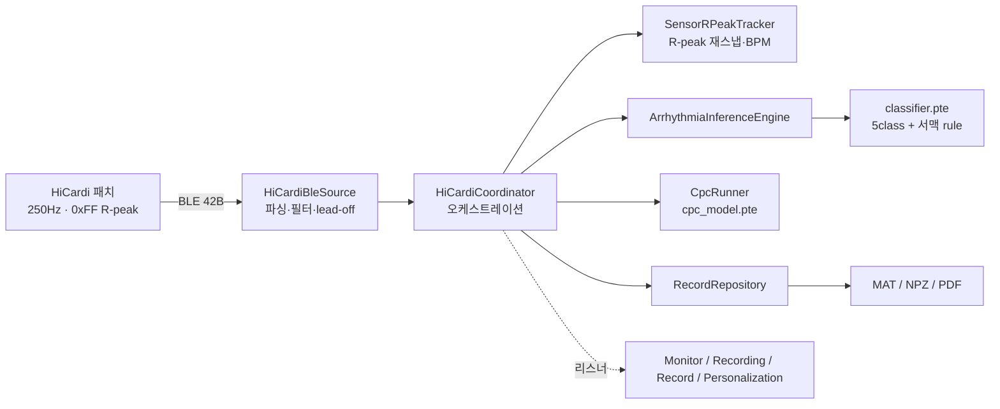

# ECG-Realtime-monitor (HiCardiMonitor)

HiCardi 패치(단일 리드 ECG · 250 Hz · BLE)를 위한 **안드로이드 실시간 심전도 모니터 + 개인화 부정맥 분석** 앱.
온디바이스 ExecuTorch 추론으로 실시간 6→5클래스 부정맥 분류, CPC 기반 개인화, 임상 캘리브레이션 표시, 연속 레코딩·다중 포맷 내보내기(MAT/NPZ/PDF)를 제공합니다.

> 상세 설계·UML·알고리즘·명세는 **[docs/DESIGN_SPEC.md](docs/DESIGN_SPEC.md)** 참조.

---

## 주요 기능

- **실시간 모니터** — sweep 파형, 임상 캘리브레이션(**20 mm/mV · 25 mm/s**, 진짜 mV), 1 mV 마커, BPM
- **R-peak 재스냅** — 센서 0xFF 플래그의 ~340 ms 위치 지연을 backward 창에서 QRS로 교정(단위테스트: 실 녹화 98 %@60 ms, 중앙값 0 ms)
- **부정맥 분류** — 5클래스(Normal / Sinus_Tachy / APC / AF_AFL / VPC) sigmoid 멀티라벨 + **서맥은 BPM rule** 판정
- **개인화(CPC)** — 60초 캘리브레이션 → 59개 2초 윈도우 → `patient_vec[256]`
- **lead-off 게이팅** — 전극 미접촉 추정 시 추론·R-peak·BPM 중단(파형·기록은 유지)
- **레코딩** — 중지할 때까지 연속 녹화, 저장/삭제
- **내보내기** — ADC/mV × **MATLAB v5(.mat)** / **NumPy(.npz)**, 그리고 **임상 strip-view PDF 리포트**
- **성능** — 비동기 목록·메타 사이드카·UI 펄스 병합으로 탭 전환 잰크 제거(99p 2650 ms → 17 ms)

---

## 화면

| 실시간 모니터 (20 mm/mV · 25 mm/s) | Strip-view PDF 리포트 |
|---|---|
|  |  |

---

## 아키텍처 개요



전체 컴포넌트·클래스·시퀀스·상태 다이어그램은 [설계 명세서](docs/DESIGN_SPEC.md) 참조.

---

## 빌드

`java`가 PATH에 없으면 Android Studio 번들 JBR을 사용:

```powershell
$env:JAVA_HOME = "C:\Program Files\Android\Android Studio\jbr"
$env:PATH = "$env:JAVA_HOME\bin;$env:PATH"
.\gradlew.bat :app:assembleDebug          # APK
.\gradlew.bat :app:testDebugUnitTest      # 단위테스트(R-peak 재스냅 · exporter)
```

SDK 경로는 `local.properties`(gitignore됨)에 지정. ExecuTorch 러너는 `app/libs/executorch.aar`, 온디바이스 모델은 `app/src/main/assets/*.pte`.

---

## 온디바이스 모델 (SSOT 계약)

| 모델 | 입력 | 출력 |
|---|---|---|
| `classifier.pte` | x[1,1,501] mV · patient_vec[1,256] · clinical[1,32] | logits[1,6] → sigmoid 멀티라벨 |
| `cpc_model.pte` | window[1,1,500] | embedding[1,256] |

상수: FS 250 Hz, ADC mV = `(adc−16384)/1000`, beat 501(±250), clinical 32-D, 캘리브 59창(60 s·2 s·1 s stride). 서맥 로짓[4]은 폐기하고 BPM rule로 대체.

---

## 프로젝트 구조

```
app/src/main/java/com/example/hicardimonitor/
  HiCardiCoordinator.kt        오케스트레이션(단일 진실)
  HiCardiBleSource.kt          BLE 파싱·필터·lead-off
  SensorRPeakTracker.kt        R-peak backward 재스냅·BPM
  session/                     추론 엔진 · CPC · 레코딩 매니저
  data/                        레코드 저장 · MAT/NPZ/PDF 익스포터
  ui/                          모니터 · 측정 · 기록 · 개인화 · 위젯
docs/DESIGN_SPEC.md            설계·UML·알고리즘·명세
```

자세한 파일·모듈 맵은 [설계 명세서 §10](docs/DESIGN_SPEC.md) 참조.

---

## 라이선스 / 소속

Yonsei University · ISPLAB (Intelligent Signal Processing). 내부 연구용.
