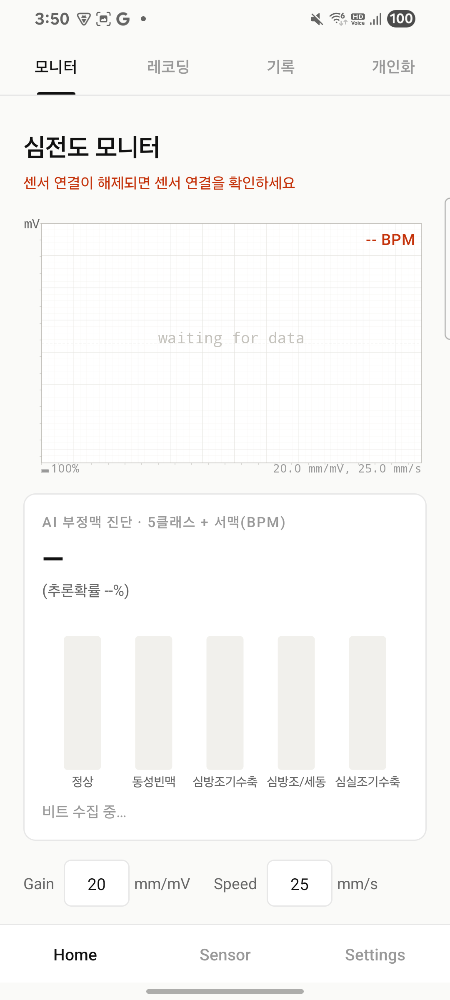
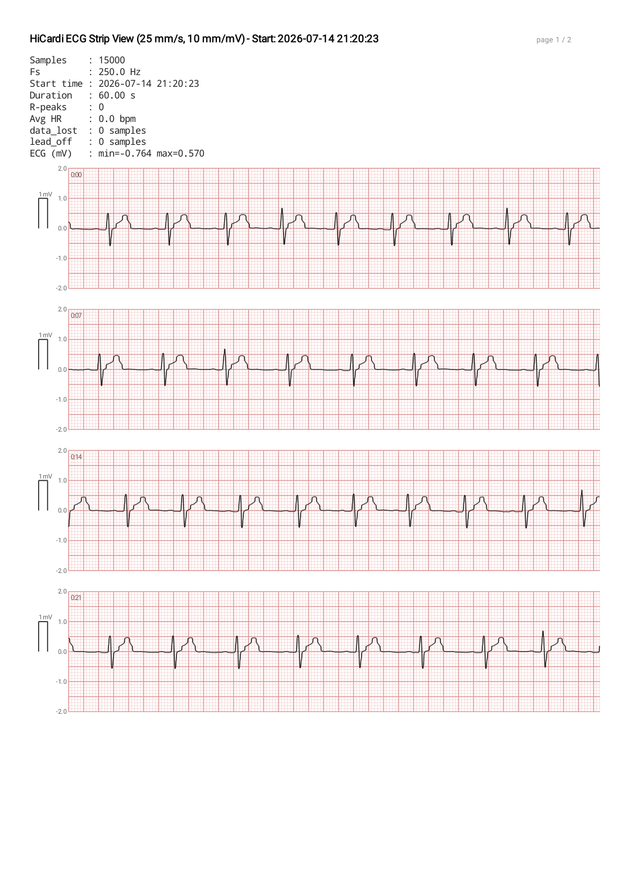
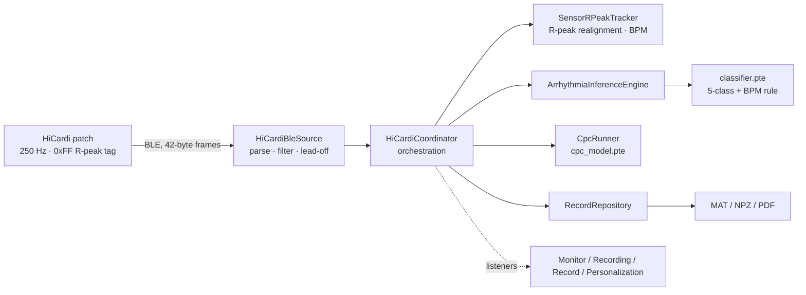

# ECG-Realtime-monitor (HiCardiMonitor)

An **Android real-time ECG monitor + personalized arrhythmia analysis** app for the
HiCardi® Smart Patch (single-lead ECG · 250 Hz · BLE). On-device ExecuTorch inference
classifies arrhythmia beats in real time with **ResDSUMamba**, a lightweight,
patient-conditioned variant of ResUMamba [Heo et al.], together with CPC-based patient
personalization, clinical-calibration display, and continuous recording with
multi-format export (MAT/NPZ/PDF).

This app is the on-device implementation companion to the master's thesis
*"Lightweight ResUMamba-based On-Device Real-Time Arrhythmia Classification for
Wearable ECG Monitoring"* (Ryuha Kim, Dept. of Computer Science, Yonsei University,
February 2027).

> For the full design, UML, algorithms, and specification, see
> **[docs/DESIGN_SPEC.md](docs/DESIGN_SPEC.md)**.

---

## Key Features

- **Real-time monitor** — sweeping waveform, clinical calibration (**20 mm/mV · 25 mm/s**,
  true mV), 1 mV marker, heart rate (BPM)
- **R-peak realignment** — corrects the sensor's on-chip R-peak tag (BLE flag `0xFF`),
  which lags the true QRS location by roughly `Δtag ≈ 340 ms`, by searching a backward
  window in the ECG waveform (minimum 240 ms between consecutive R-peaks; unit-tested on
  real recordings: 98% within 60 ms, 0 ms median error)
- **Arrhythmia classification** — 5-class (Normal / Sinus Tachycardia / APC / AF/AFL / VPC)
  sigmoid multi-label output from ResDSUMamba, with sinus tachycardia determined by a
  **heart-rate (BPM) rule** rather than the model logit
- **Personalization (CPC)** — a 60 s label-free calibration segment is encoded into a
  256-dim patient embedding vector (PEV) `patient_vec[256]` via a contrastive
  predictive coding (CPC) encoder, used to condition every subsequent beat classification
- **Lead-off gating** — inference, R-peak tracking, and BPM are paused when electrode
  contact is lost (the waveform and recording continue)
- **Recording** — continuous recording until stopped, with save/delete
- **Export** — ADC/mV in **MATLAB v5 (.mat)** / **NumPy (.npz)**, plus a
  **clinical strip-view PDF report**
- **Performance** — async list loading, metadata sidecars, and UI-pulse coalescing
  remove tab-switch jank (99th-percentile 2650 ms → 17 ms)

---

## Screens

| Real-time monitor (20 mm/mV · 25 mm/s) |
|---|
| Strip-view PDF report |
|---|
|  |
|  |

---

## Architecture Overview



This mirrors the end-to-end pipeline in Chapter 4 of the thesis (BLE acquisition →
on-device signal reconstruction → R-peak alignment → beat-level classification → display).
See the [design specification](docs/DESIGN_SPEC.md) for the full component, class,
sequence, and state diagrams.

---

## Build

If `java` is not on your `PATH`, use the JBR bundled with Android Studio:

```powershell
$env:JAVA_HOME = "C:\Program Files\Android\Android Studio\jbr"
$env:PATH = "$env:JAVA_HOME\bin;$env:PATH"
.\gradlew.bat :app:assembleDebug          # APK
.\gradlew.bat :app:testDebugUnitTest      # unit tests (R-peak realignment, exporters)
```

Set the SDK path in `local.properties` (git-ignored). The ExecuTorch runtime is
`app/libs/executorch.aar`; on-device models live in `app/src/main/assets/*.pte`.

---

## On-Device Models (SSOT Contract)

| Model | Input | Output |
|---|---|---|
| `classifier.pte` (ResDSUMamba) | `x[1,1,501]` mV · `patient_vec[1,256]` · `clinical[1,32]` | `logits[1,6]` → sigmoid multi-label |
| `cpc_model.pte` | `window[1,1,500]` | `embedding[1,256]` |

Constants: `FS = 250 Hz`, ADC → mV = `(adc − 16384) / 1000`, beat window 501 samples
(±250 samples ≈ ±1.0 s), 32-dim clinical features, 59 calibration windows (60 s record,
2 s window, 1 s stride). The sinus-tachycardia logit (index 4) is discarded and replaced
by the BPM rule.

> **Note on the ADC→mV constant:** the thesis's Eq. 4.1 describes a different BLE ECG
> encoding (two 7-bit fields packed into a 14-bit value, offset 8192) than what this app
> implements (two 8-bit fields packed into 16 bits, offset 16384/`0x4000`; see
> `HiCardiSignal.kt`, `ArrhythmiaConfig.kt`). The constant above matches the code actually
> shipped in this app, not the thesis text — if you are reconciling the two, check which
> firmware/BLE protocol revision you are targeting.

### Deployed model vs. the thesis's reported numbers

`classifier.pte` is the on-device export of **ResDSUMamba**, the depthwise-separable-
convolution variant of patient-conditioned ResUMamba studied in the thesis. On a
record-wise split of the HiCardi dataset (Table 5.2) and measured on a Galaxy S21+
(SM-G996N, Exynos 2100) with ExecuTorch + XNNPACK, FP32, single Cortex-X1 thread
(Table 5.3):

| | ResUMamba (baseline) | ResDSUMamba (deployed) |
|---|---:|---:|
| Params / MACs | 2.4883 M / 721.50 M | 1.3225 M / 331.38 M (−46.9% / −54.1%) |
| Macro-F1 / Micro-F1 | 42.28% / 79.27% | 44.15% / 83.29% |
| Macro-Se | 78.00% | 75.72% |
| $T_{\text{model}}$, portable → XNNPACK | 1073.57 ms → 48.25 ms | 611.50 ms → 36.70 ms (P95 38.90 ms) |

In a 309.21 s live patch-connected session (413 beats, mean heart rate 80.2 bpm), mean
$T_{\text{beat}}$ was 59.4 ms (P95 70.3 ms), inference-thread CPU utilization was 7.9%, and
peak native heap was 99.2 MB. The live session used no reference labels, so on-device
classification accuracy was not evaluated in it.

---

## Project Structure

```
app/src/main/java/com/example/hicardimonitor/
  HiCardiCoordinator.kt        orchestration (single source of truth)
  HiCardiBleSource.kt          BLE parsing, filtering, lead-off
  SensorRPeakTracker.kt        R-peak backward realignment, BPM
  session/                     inference engine, CPC, recording manager
  data/                        record storage, MAT/NPZ/PDF exporters
  ui/                          monitor, measurement, record, personalization, widgets
docs/DESIGN_SPEC.md            design, UML, algorithms, specification
```

See [design specification §10](docs/DESIGN_SPEC.md) for the full file/module map.

---

## License / Affiliation

Yonsei University · ISPLAB (Intelligent Signal Processing). For internal research use.
