# HiCardiMonitor — 설계·명세서 (Design Specification)

> HiCardi 패치(단일 리드 ECG, 250 Hz, BLE)를 위한 안드로이드 실시간 심전도 모니터·개인화 부정맥 분석 앱.
> 본 문서는 코드 기준의 단일 진실 소스(SSOT)로, 아키텍처·UML·알고리즘·데이터 명세·개발 진행도를 담는다.

- 대상 플랫폼: Android (minSdk 확인 요), Kotlin, ExecuTorch(온디바이스 추론)
- 센서: HiCardi 패치 `EB:B5:51:19:06:24` / `HiCardi-07143`, Nordic UART Service
- 샘플링레이트: 250 Hz
- 온디바이스 모델: `cpc_model.pte`(개인화 인코더), `classifier.pte`(6-로짓 부정맥 분류기), `model.pte`(레거시 27-class)


---

## 1. 시스템 아키텍처 (Component / Deployment)

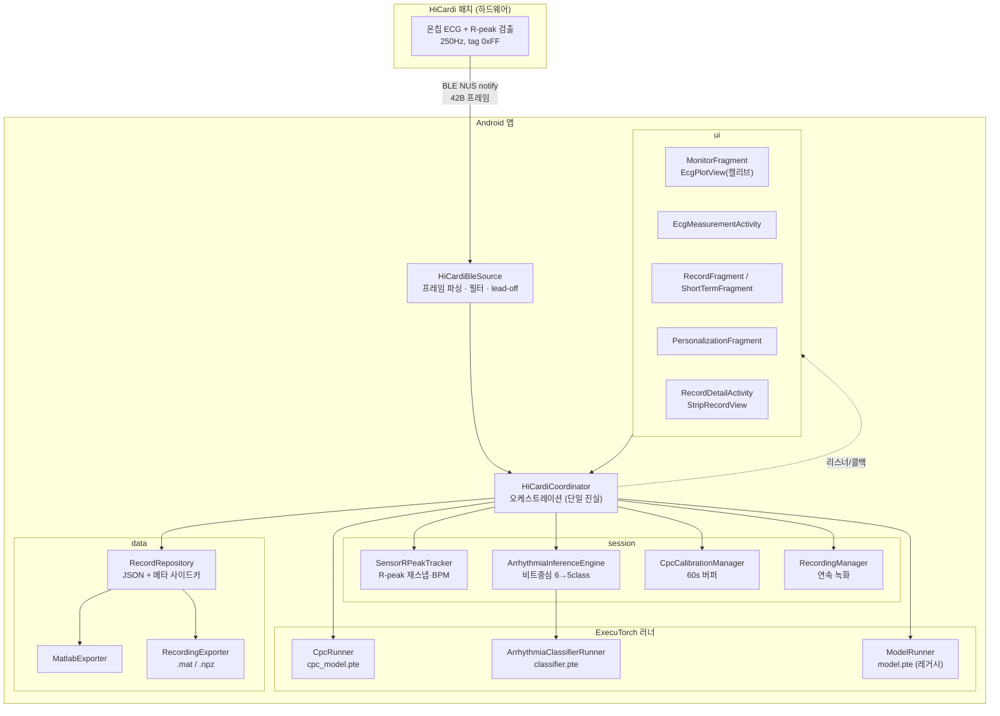

**설계 원칙**
- `HiCardiCoordinator`가 모든 상태·모델·기록의 단일 오케스트레이터. UI는 리스너로 구독만 한다.
- BLE 배치 처리 파이프라인은 **단일 스레드(`bleExecutor`)로 직렬화** → 공유버퍼 경합 원천 차단.
- 무거운 일회성 추론(CPC 인코딩)은 **별도 `inferenceExecutor`** 로 오프로드해 배치 파이프라인을 막지 않는다.
- UI 반영은 **`mainHandler`** 로만, 배치마다 post 하지 않고 **펄스 병합**으로 메인 루퍼 부하를 낮춘다.

---

## 3. 클래스 다이어그램

### 3.1 오케스트레이션 & 세션

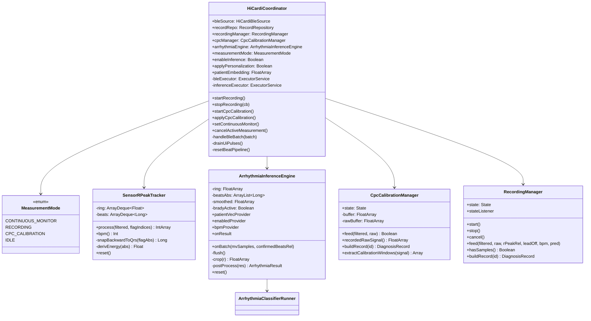

> `@Volatile`(스레드 공유): `measurementMode`, `enableInference`, `applyPersonalization`, `patientEmbedding`, `lastBpm`, `lastPred`, 각 매니저의 `state`. `extractCalibrationWindows`는 static. `CpcCalibrationManager`의 두 버퍼는 15,000 샘플(60초).

### 3.2 BLE 소스 & 신호

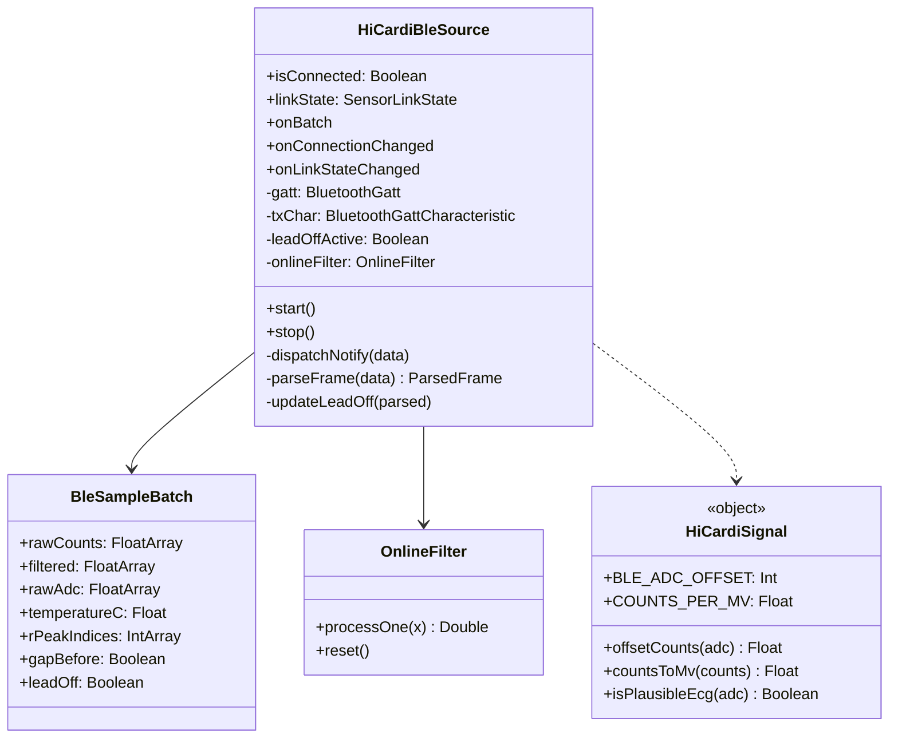

> `BleSampleBatch`: `rawCounts` = `adc−16384`(오프셋 counts), `filtered` = OnlineFilter→mV(÷1000), `rawAdc` = 원 ADC, `rPeakIndices` = 0xFF 위치. `HiCardiSignal`: `BLE_ADC_OFFSET=0x4000`, `COUNTS_PER_MV=1000`. `@Volatile`: `isConnected`, `linkState`, `gatt`, `txChar`, `leadOffActive`.

### 3.3 추론 모델 계층

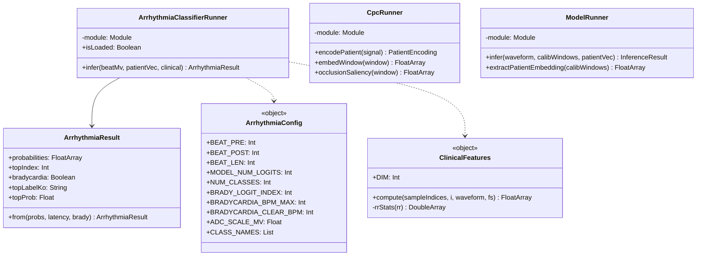

> 값(§8 계약): `ArrhythmiaClassifierRunner.infer(beatMv[501], patientVec[256], clinical[32])`; `ArrhythmiaConfig` = `BEAT_PRE/POST=250, BEAT_LEN=501, MODEL_NUM_LOGITS=6, NUM_CLASSES=5, BRADY_LOGIT_INDEX=4, BPM_MAX=60, CLEAR_BPM=62, ADC_SCALE_MV=1000`, `CLASS_NAMES=[Normal,Sinus_Tachy,APC,AF_AFL,VPC]`. `from(...)`은 static.

### 3.4 데이터 모델 & 저장

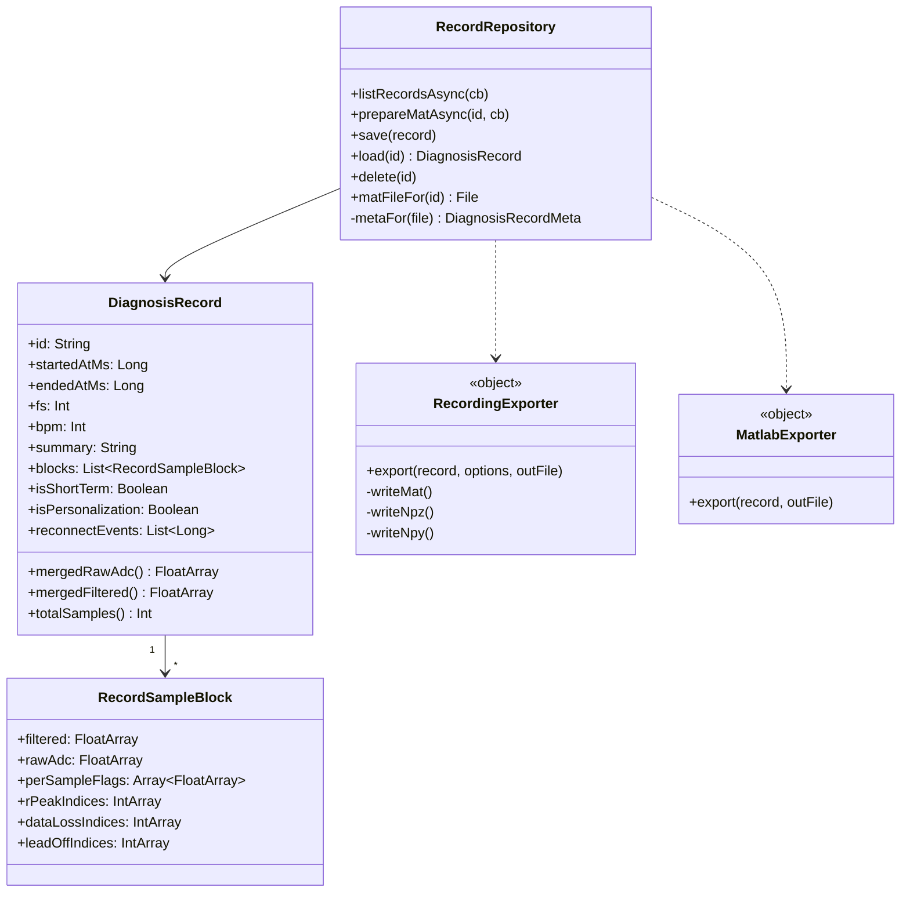

> `RecordRepository`의 `listRecordsAsync`/`prepareMatAsync`는 IO 스레드 → 메인 콜백. `metaFor`는 `.meta.json` 사이드카(본문 full-parse 회피). `RecordingExporter.Options(includeAdc, includeMv, format∈{MAT,NPZ})`; `MatlabExporter`는 v5 7-변수.

---

## 4. 시퀀스 다이어그램

### 4.1 실시간 모니터 — 배치 처리 & 추론

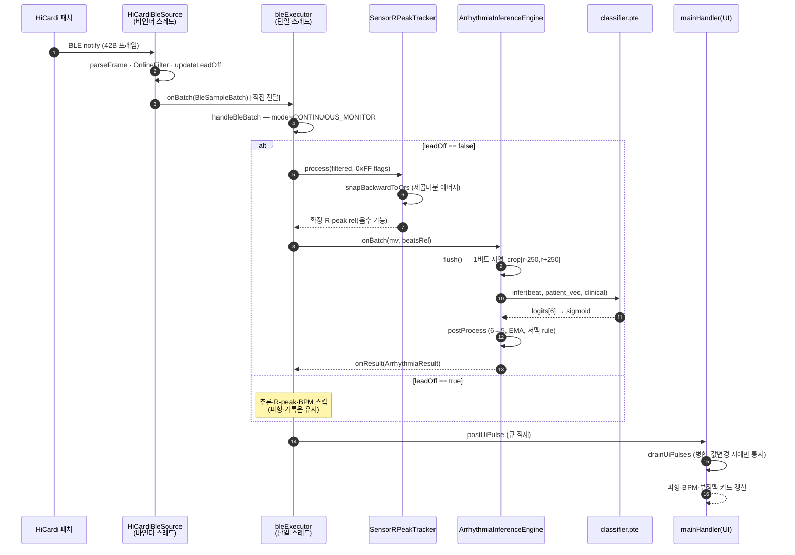

### 4.2 레코딩 — 시작 → 중지 → 저장/내보내기

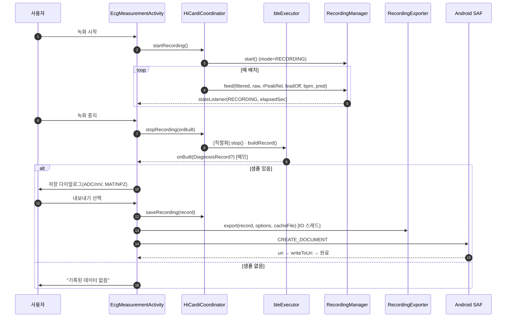

### 4.3 CPC 개인화 캘리브레이션 (60초)

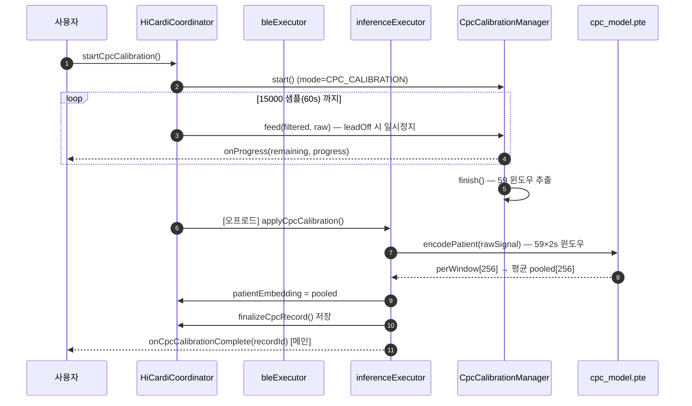

---

## 5. 상태 기계 (State Machines)

### 5.1 측정 모드 (MeasurementMode)

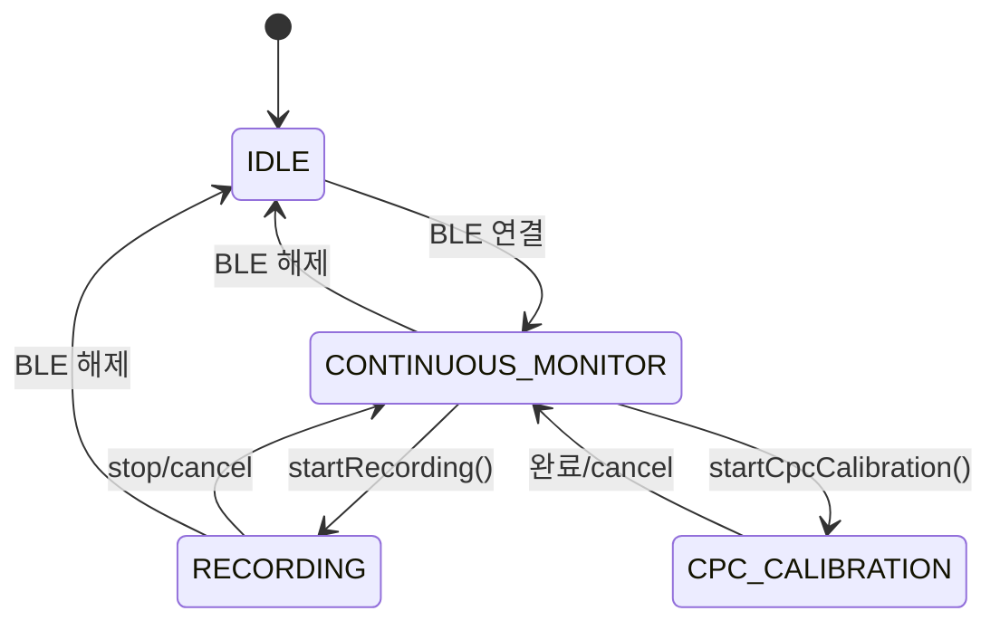

### 5.2 서맥 rule (BPM 히스테리시스)

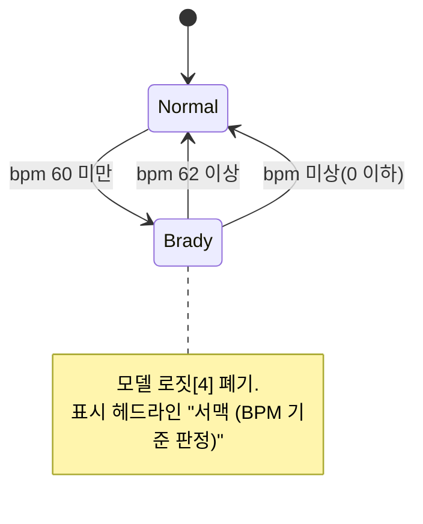

### 5.3 lead-off 휴리스틱 (프레임 폐기 비율)

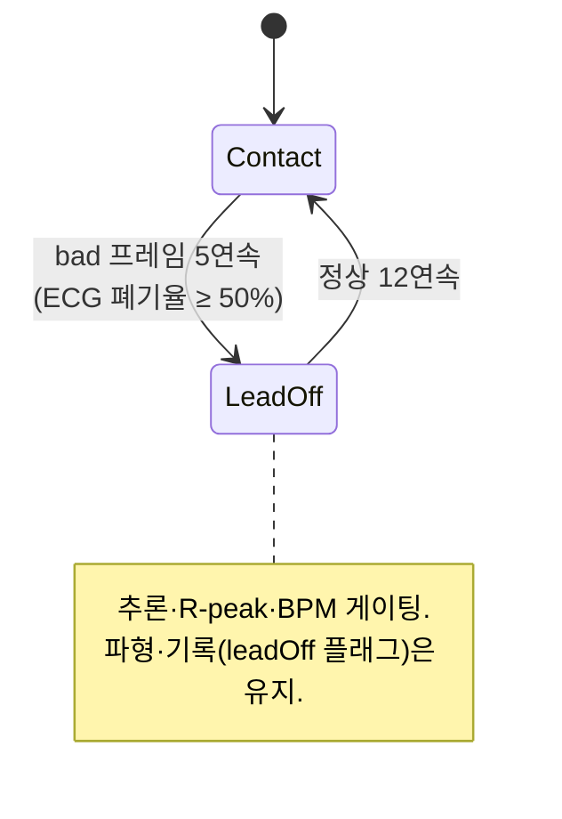

---

## 6. 스레딩 모델

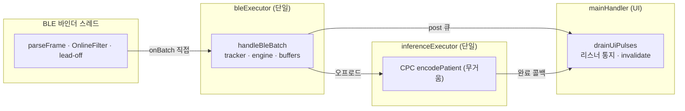

**가시성·동시성 규칙**
- 두 스레드가 공유하는 필드는 `@Volatile`: `measurementMode`, `enableInference`, `applyPersonalization`, `patientEmbedding`, `lastBpm`, `lastPred`, BLE의 `gatt/txChar/isConnected/linkState/leadOffActive`, 각 매니저 `state`.
- 리스너 목록은 `CopyOnWriteArrayList` — 콜백 내 자기 제거 시 `ConcurrentModificationException` 방지.
- `stopRecording`·`resetBeatPipeline`은 `bleExecutor`에 직렬화해 배치 처리와의 경합 차단.
- tracker·engine 내부 상태는 오직 `bleExecutor`에서만 접근.

---

## 7. 알고리즘

### 7.1 R-peak backward 재스냅 (핵심 신규)

**문제.** 센서 온칩 0xFF 플래그는 박동 **개수·간격(RR)은 정확**하나 **위치가 실제 QRS보다 ~340ms 늦게**(직전 QRS를 뒤늦게) 보고된다. 실측(`rec.npz`): 플래그가 QRS로부터 −360ms/+324ms(RR 684ms)로 거의 중앙에 위치, 기존 ±60ms 전방 스냅 적중률 0%. 영향: 표시 마커 오위치 + **6-class 비트 crop[r−250,r+250]이 기저선 중심**으로 잘림.

**해법.** 0xFF는 트리거·refractory로만 쓰고, 위치는 플래그 기준 **backward 창에서 제곱미분 에너지 최대 → 원신호 극점**으로 재스냅. backward라 미래 샘플 불필요(즉시 확정).

```
snapBackwardToQrs(flagAbs):
  loC = flagAbs - 0.50*fs      # 500ms 전
  hiC = flagAbs - 0.20*fs      # 200ms 전
  if 히스토리 부족: return flagAbs
  mean = ring[loC..hiC] 평균        # 베이스라인 근사
  bestC = argmax_c derivEnergy(c),  c in [loC, hiC]
  # derivEnergy(i) = mean_{k=-3..3} ((ring[i+k+1]-ring[i+k-1])/2)^2
  bestR = argmax_r |ring[r] - mean|, r in [bestC±0.02*fs]
  return bestR
```

**설계 근거(대안 비교, 모두 `rec.npz`로 검증).**

| 방법 | 개수 | 위치 정확 | 비고 |
|---|---|---|---|
| 0xFF 원본 | 64 | 0% @60ms, +294ms | 위치 사용 불가 |
| 독립 Pan-Tompkins(스트리밍) | 30 | 100% 정밀, recall 47% | 임계 튜닝 난해, 개수 손실 |
| 대칭 ±360ms 스냅 | — | RR 붕괴 | 앞뒤 QRS 모두 포함(중앙) → 불가 |
| **backward 방향성(채택)** | **64** | **100%@60ms, +2ms, 충돌 0** | 개수 보존 + 위치 정확 |

**단위테스트**(`SensorRPeakTrackerTest`, 실 녹화 CSV fixture 스트리밍): **n=64, 98%@60ms, 중앙값 0ms**.

**하류 처리.** 재스냅 결과 rel은 음수(과거 ~90샘플)일 수 있음 — 기록/모델 crop은 절대 인덱스로 교정 위치를 받고, `EcgPlotView`는 음수 rel을 과거 버퍼 위치에 매핑해 마킹.

### 7.2 Pan-Tompkins 스트리밍 지연 측정(설계 검증용)

완전 causal PT(butter(2,[5,15]Hz) biquad → causal 5-tap 미분 → 제곱 → 120ms trailing 적분 → 적응 임계 SPKI/NPKI)로 **MWI 피크가 실제 QRS보다 일정하게 ~96ms(p10–p90 64–102ms) 지연**됨을 측정. 이 값이 backward 창(≥200ms) 설정의 근거이며, 독립 PT는 recall 부족으로 트리거로는 미채택.

### 7.3 임상 32-D clinical features (SSOT bit-parity)

`ClinicalFeatures.compute`는 `PECG-HiCardi/src/data/clinical_features.py`와 정확 일치(목표 max|Δ|<1e-5).

```
rr_all[i] = (sampleIndex[i+1]-sampleIndex[i]) / fs
pre_rr  = rr_all[i-1] (i>0 else 0);   post_rr = rr_all[i] (i<n-1 else 0)   # 1-beat lag
local  = rr_all[i-10:i];  global = rr_all[i-20:i]    # 과거만
rr_stats: mean, std(ddof=0)+1e-8, skew, excess_kurtosis
feat[0..9]  = pre, post, pre/(lm+ε), post/(lm+ε), lm, ls, lsk, lku, gm, gs
feat[10]    = max-min (P-P)
feat[11]    = sqrt(mean(seg^2)) (RMS)
feat[12]    = mean(seg[0.4L:0.6L]^2)  (중앙 20% 에너지)
feat[13:32] = seg[linspace(0,L-1,19) → int]   # truncation
```
비트 crop `seg`는 `(adc-16384)/1000` mV(모델 입력과 동일 스케일).

### 7.4 CPC 개인화 임베딩

```
59 윈도우 = floor((15000-500)/250)+1   # 60s, 2s창, 1s stride (SSOT CALIB_NUM_WINDOWS)
각 윈도우 w(500샘플): z-score → cpc_model.pte → emb[256] → L2정규화
pooled = mean_w(emb) → L2정규화 = patient_vec[256]
```
주 경로 `CpcRunner.encodePatient`는 신호 전체를 hop=250으로 타일링해 자동으로 59창 생성(상수 `NUM_CALIB` 미사용). `NUM_CALIB=59`는 레거시 `model.pte`(`[1,59,1,500]`) 전용이며 shape 불일치 시 무조건부 forward로 폴백.

### 7.5 서맥 rule (모델 미사용)

```
postProcess(res):
  probs5 = drop(res.logits, idx=BRADY_LOGIT_INDEX=4)   # 6→5, VPC 5→4
  sm = EMA(probs5, α=0.3)
  bradyActive = (bpm<=0 → false) | (bpm<60 → true) | (bpm>=62 → false) | else 유지
  return ArrhythmiaResult(sm, bradycardia=bradyActive)
```
서맥은 정의상 심박수 기준(HR<60)이라 모델(AUPRC 낮음) 대신 BPM 히스테리시스로 판정.

### 7.6 lead-off 휴리스틱

```
프레임마다: ecgTags = 유효 + 폐기(isPlausibleEcg 실패)
bad = (폐기 ≥ 유효)                # ECG 태그 절반 이상 비생리
연속 bad 5회 → LeadOff 진입;  연속 정상 12회 → 해제
LeadOff 동안: 추론·R-peak·BPM 게이팅(파형·기록 유지)
```
전용 플래그 부재로 신호 특성(전극 탈착 시 레일/이상치)으로 추정. 한계: "깨끗한 평탄선" 탈착은 미검출(향후 진폭/분산 기반 보강 예정).

### 7.7 임상 캘리브레이션 렌더링

```
캘리브레이션 모드(20mm/mV, 25mm/s):
  pxPerMm = dpi / 25.4
  가시 yRange = plotH_px / (mmPerMv × pxPerMmY),  0mV 중앙
  가시 xWindowSec = plotW_px / (mmPerSec × pxPerMmX)   # onSizeChanged
  그리드: 1mm 얇은선 / 5mm 굵은선
  1mV 마커 높이 = mmPerMv × pxPerMmY
표시 신호 = (adc-16384)/1000 mV (SSOT)
```

### 7.8 UI 펄스 병합(성능)

배치(≈22/s)마다 post하지 않고 큐 적재 → 메인 루퍼 유휴 시 `drainUiPulses`가 일괄 처리. 파형은 전 배치를 그려 연속성 유지, BPM·진단·체온은 **값이 바뀔 때만** 리스너 통지(불필요 레이아웃 패스 제거).

---

## 8. 온디바이스 모델 명세 (SSOT 계약)

출처: `G:\...\classifier\DEPLOYMENT_ONDEVICE_SPEC.md`

**상수 (변경 불가)**
```
FS_HZ=250, ADC_SCALE=1000
BEAT_PRE=250, BEAT_POST=250, BEAT_LEN=501
CLINICAL_DIM=32, PATIENT_DIM=256
CALIB_SECONDS=60, CALIB_WINDOW_SEC=2.0, CALIB_OVERLAP=0.5, CALIB_NUM_WINDOWS=59
MULTILABEL_THRESHOLD=0.5
```
ADC→mV: Holter `(adc-8192)/1000`, **HiCardi 모니터 `(adc-16384)/1000`**.

**모델 계약**
| 모델 | 입력 | 출력 |
|---|---|---|
| `classifier.pte` | x[1,1,501] mV, patient_vec[1,256], clinical[1,32] | logits[1,6] → **sigmoid 멀티라벨** |
| `cpc_model.pte` | window[1,1,500] (z-score) | embedding[1,256] |
| `model.pte`(레거시) | beat[1,1,501] + calib[1,59,1,500] | logits (27-class) |

**클래스(로짓 순서, 6):** `Normal, Sinus_Tachy, APC, AF_AFL, Bradycardia, VPC`.
**앱 표시(5):** 서맥 로짓[4] 폐기 → `Normal, Sinus_Tachy, APC, AF_AFL, VPC`; 서맥은 rule로 별도 표기.

> ⚠️ 출력은 **sigmoid 멀티라벨(합≠1)** — 서맥 로짓 폐기 후 재정규화 금지(독립 확률·0.5 임계 붕괴).

---

## 9. 데이터 명세

### 9.1 BLE 42-byte 프레임

```
byte 0      : 0x80 sync
byte 1      : 프레임 시퀀스 카운터
byte 2-4    : 63 01 00 상수
byte 5-7    : tag 0xF1 별도 채널(메인 ECG 아님)
byte 8-37   : ECG 10샘플 [tag, hi, lo]; value=(hi<<8|lo)-0x4000, 250Hz
              tag 0xF0=정상, 0xFF=R-peak 표시 샘플
byte 38-40  : 텔레메트리 멀티플렉스(회전 필드 id, 온도 포함)
byte 41     : 0x8F 프레임 끝
```

### 9.2 레코드 JSON 스키마 (`{id}.json`)

```
{ id, startedAtMs, endedAtMs, fs, bpm, summary,
  isShortTerm, isPersonalization, reconnectEvents[],
  blocks[ { filtered[], rawAdc[], perSampleFlags[][],
            rPeakIndices[], dataLossIndices[], leadOffIndices[] } ] }
```
목록 성능용 사이드카 `{id}.meta.json`: `{id, startedAtMs, bpm, summary, isShortTerm, isPersonalization}` (본문 full-parse 회피).

### 9.3 레코딩 내보내기 (`RecordingExporter`, .mat v5 / .npz)

샘플 정렬 float64 컬럼 + 스칼라:

| 컬럼 | 의미 |
|---|---|
| `ecg_adc[n]` | 원 16bit ADC |
| `ecg_mv[n]` | `(adc-16384)/1000` **진짜 mV** |
| `rpeak[n]` | 센서 R-peak(재스냅 위치) 0/1 |
| `data_lost[n]` / `lead_off[n]` | 0/1 |
| `t_sec[n]` | 시작 기준 경과 초 = i/fs |
| `ts_ms[n]` | epoch ms = start_ms + i·1000/fs |
| `fs[1]`, `start_ms[1]` | 스칼라 |

장시간 녹화도 힙에 통째로 올리지 않는 **값 단위 스트리밍 작성**. scipy `loadmat`·numpy `np.load` 로드 검증 완료.

### 9.4 레거시 `.mat` (`MatlabExporter`, v5, 7변수)

`dECG, final_flag, Rpk_flag, fs, Rthm_label, data_lost, LeadOff` — scipy 호환.

---

## 10. 파일·모듈 맵

| 영역 | 경로 |
|---|---|
| 오케스트레이션 | `HiCardiCoordinator.kt`, `MeasurementMode.kt` |
| BLE·신호 | `HiCardiBleSource.kt`, `BleSampleBatch.kt`, `HiCardiSignal.kt`, `OnlineFilter.kt`, `SensorRPeakTracker.kt` |
| 세션 | `session/ArrhythmiaInferenceEngine.kt`, `CpcCalibrationManager.kt`, `RecordingManager.kt`, `CpcRunner.kt`, `PersonalizationQuality.kt` |
| 모델 | `ArrhythmiaClassifierRunner.kt`, `ArrhythmiaConfig.kt`, `ClinicalFeatures.kt`, `ModelRunner.kt`, `ModelConfig.kt` |
| 데이터 | `data/DiagnosisRecord.kt`, `RecordRepository.kt`, `RecordingExporter.kt`, `MatlabExporter.kt`, `RecordMatActions.kt` |
| 표시 | `EcgPlotView.kt`, `GraphSettings.kt`, `StripRecordView.kt`, `StripRecordBuffer.kt` |
| UI | `ui/home/*Fragment.kt`, `ui/measurement/EcgMeasurementActivity.kt`, `ui/record/RecordDetailActivity.kt`, `ui/widget/*` |
| 테스트 | `test/.../SensorRPeakTrackerTest.kt`, `RecordingExporterTest.kt`, `test/resources/rec_*.csv` |

---

## 11. 검증 현황

| 항목 | 방법 | 결과 |
|---|---|---|
| R-peak 재스냅 | JVM 단위테스트(실 녹화 스트리밍) | n=64, 98%@60ms, 중앙값 0ms ✅ |
| 내보내기 포맷 | scipy 1.17 / numpy 2.3 로드·값 대조 | mV·rpeak·타임스탬프 일치 ✅ |
| 탭 전환 성능 | adb `dumpsys gfxinfo` | 99p 2650ms→17ms, 잰크 소멸 ✅ |
| 캘리브레이션 표시 | 기기 스크린샷 | "20.0mm/mV, 25.0mm/s" + mm그리드 ✅ |
| 모델 로드 | adb logcat | 3개 .pte 로드 OK, 크래시 없음 ✅ |
| clinical 32-D | Python parity | max|Δ|<1e-5 ✅ |

**빌드:** Android Studio JBR + `gradlew :app:assembleDebug` (java PATH 미등록 환경).

---

## 12. 남은 과제 (Backlog)

1. **움직임 구간 품질 게이팅** — motion SQI(분산/진폭 급증) 기반으로 고아티팩트 구간 추론 일시정지.
2. **RecordDetail 비동기화** — 상세 진입 시 full-JSON 파싱(장시간 녹화 수백 ms~초)을 IO 스레드로.
3. **라이브 파형 캘리브레이션 최종 확인** — 실 센서로 20mm/mV 진폭·클리핑 육안 검증, 필요 시 게인 기본값 조정.
4. **lead-off 보강** — 평탄선(진폭 소실) 탈착 케이스 감지 추가.
5. **COUNTS_PER_MV 실측 재확인** — 장비 LSB 문서와 대조(현재 SSOT 1000 채택).

---

*문서 갱신: 코드 변경 시 본 파일을 SSOT로 함께 갱신할 것. 다이어그램은 Mermaid — GitHub·Android Studio(Mermaid 플러그인)·VS Code에서 렌더링.*
