# HiCardiMonitor — Design Specification

HiCardi 패치(단일 리드 ECG, 250 Hz, BLE)를 위한 Android 실시간 심전도 모니터링 및 개인화 부정맥 분석 앱의 설계 명세다.

- 대상 플랫폼: Android (`minSdk` 확인 필요), Kotlin, ExecuTorch
- 샘플링레이트: 250 Hz
- 입력 장치: HiCardi Smart Patch, 단일 리드 ECG, BLE NUS
- 온디바이스 모델:
  - `cpc_model.pte`: CPC 개인화 인코더
  - `classifier.pte`: Stage A 비트 단위 3-class sigmoid 분류기

## 분류 구조 요약

- **Stage A — Beat-level classification:** 각 ECG 비트에 대해 `Normal`, `APC`, `VPC`의 독립적인 sigmoid 점수를 산출한다.
- **Beat score map:** 비트별 점수와 해당 R-peak 위치를 시간순으로 축적한다.
- **Stage B — Rhythm-level classification:** beat score map을 입력으로 사용해 `AF_AFL`, `Sinus_Tachy` 등의 리듬을 판별하는 단계다. 현재 설계 대상이며, `docs/beat_score_map/beat_score_classifier.py`가 준비되기 전까지 구현 완료된 기능으로 간주하지 않는다.
- **Bradycardia:** 모델 클래스가 아니라 BPM 히스테리시스 규칙으로 별도 판정한다.

---

## 0. Stage A — Beat-score-map Backbone

### 0.1 목적과 클래스

Stage A는 각 ECG 비트에서 다음 세 클래스의 점수를 산출하는 비트 단위 백본이다.

- `Normal`
- `APC`
- `VPC`

`AF_AFL`과 `Sinus_Tachy`는 Stage A에서 직접 분류하지 않는다. 학습 라벨을 세 클래스에 맞춰 재매핑할 때, 이 두 라벨만 활성화된 비트는 `Normal` fallback으로 처리한다. 해당 리듬의 판별은 향후 Stage B에서 수행한다.

### 0.2 출력 및 loss

- 출력: 클래스별 독립 sigmoid 점수 3개
- Loss: `BCEWithLogitsLoss`
- 추론 임계값: `0.5`
- Softmax: 사용하지 않음
- 출력 재정규화: 사용하지 않음

APC와 VPC가 동시에 활성화되는 원본 라벨이 관찰되어 멀티라벨 형식을 유지한다. 이 사실은 라벨의 중첩을 표현하기 위한 설계 근거이며, 멀티라벨이 softmax보다 분류 성능이 우수하다는 증거는 아니다. sigmoid 점수는 합이 1일 필요가 없고, 임계값 적용 뒤 둘 이상의 클래스가 동시에 활성화될 수 있다.

### 0.3 라벨 매핑

`_resolve_label_multihot`에 다음 클래스 순서를 전달한다.

```python
class_names = ['Normal', 'APC', 'VPC']
```

원본 라벨 열 매핑은 `cols=[0, 14, 3]`이다. 선택한 세 클래스에서 활성 라벨이 없는 비트는 `Normal` fallback으로 처리한다. 따라서 `AF_AFL`(원본 열 12) 또는 `Sinus_Tachy`(원본 열 16)만 활성화된 비트는 `Normal`로 매핑된다. 이 동작은 제공된 실데이터에서 확인된 것으로 기록되어 있다.

> 학습 라벨의 `Normal` fallback과 추론 단계의 sigmoid 임계값 처리는 별개다. 라벨 재매핑에서 `Normal`로 처리되었다고 해서 추론 단계에서도 언제나 `Normal`을 강제로 선택하거나, 세 sigmoid 점수를 합이 1이 되도록 정규화한다는 뜻은 아니다.

### 0.4 라벨 분포

| 클래스 | 비트 수 | 비율 |
|---|---:|---:|
| Normal | 19,199,830 | 98.822% |
| APC | 127,226 | 0.655% |
| VPC | 101,674 | 0.523% |
| **합계** | **19,428,730** | **100.000%** |

최대/최소 클래스 비율은 약 `189:1`이다. 5-class 라벨 체계에서 AF_AFL이 차지하던 비율이 3-class 재매핑에서는 Normal 쪽으로 흡수되므로, APC와 VPC에 대한 불균형이 더 심해진다. `compute_pos_weights()`로 양성 가중치를 자동 산출하며, 가중치 상한은 50이다.

### 0.5 학습 설정 및 평가 제한

- 초기 체크포인트: `deploy_all_resdsu_2ep/best.ckpt`
- 초기 체크포인트의 `global_step`: `465,112`
- 초기화 방식: `--init-from` — PyTorch Lightning resume가 아님
- 초기화 범위: 형상이 일치하는 텐서만 복사
- 분류 헤드: 기존 5-class에서 3-class로 바뀌므로 새로 초기화
- Optimizer 상태 및 epoch 상태: 복원하지 않음
- Epoch: `1`
- Seed: `42`
- Batch size: `16`
- 옵션: `--class-set 3`, `--dw-sep 1`
- 데이터 설정: `split_deploy_all.json`
- 데이터 구성: `275 records / 3,720,904 samples`
- 학습 데이터: train, validation, test를 모두 학습에 사용


### 0.6 Stage B 연계

Stage B는 beat score map의 시간적 패턴을 이용해 리듬을 분류하는 단계다.

- 리듬 분류기의 최종 클래스 집합 및 라벨 정의
- 입력 시간 창과 최소 유효 비트 수
- 출력 텐서 shape 및 후처리 규칙
- Stage B의 `.pte` 파일명과 ExecuTorch 실행 경로
- 임상 라벨 기준의 독립적인 검증 결과

Stage B를 구현하기 전까지 앱 명세에서 AF_AFL 또는 Sinus_Tachy의 실시간 분류가 구현 완료된 것으로 표현하지 않는다.

---

## 1. 시스템 아키텍처 (Component / Deployment)

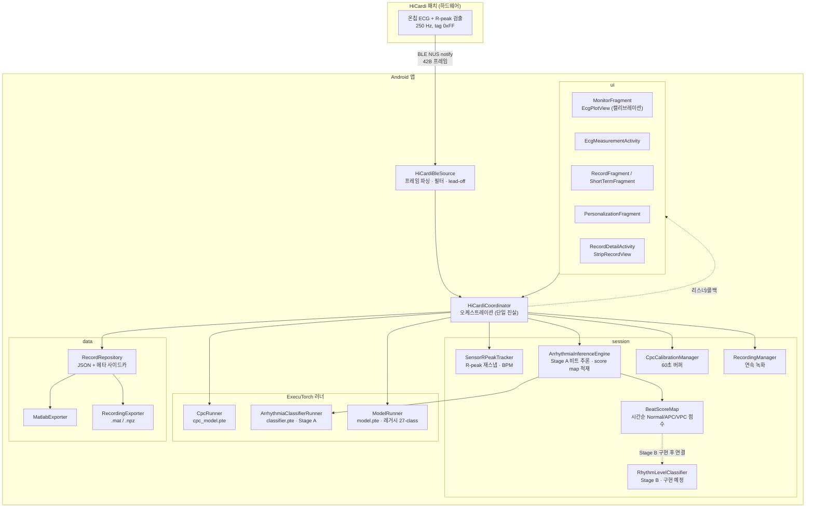

점선으로 표시한 `BeatScoreMap → RhythmLevelClassifier` 연결은 향후 Stage B를 구현한 후 활성화할 경로다. Stage B가 구현되기 전에는 이 연결을 실행 중인 기능으로 해석하지 않는다.

### 설계 원칙

- `HiCardiCoordinator`가 앱 상태, 모델 실행 요청, 기록 작업의 오케스트레이터 역할을 한다.
- BLE 배치 처리 파이프라인은 단일 스레드(`bleExecutor`)에서 직렬화해 tracker, 추론 엔진, 공유 버퍼 간 경합을 방지한다.
- 무거운 일회성 CPC 인코딩은 별도 `inferenceExecutor`로 오프로드해 배치 파이프라인을 막지 않는다.
- UI 반영은 `mainHandler`에서만 수행한다. 배치마다 UI 작업을 무조건 post하지 않고 펄스를 병합한다.
- Stage A 출력은 `Normal/APC/VPC` 독립 점수다. 이를 기존 5-class 단일 부정맥 결과로 해석하지 않는다.
- Stage B 결과와 Stage A 점수를 별도 개념으로 관리한다.
- 서맥은 BPM 규칙 결과이며 Stage A 모델 출력에 포함하지 않는다.
- `model.pte`의 레거시 27-class 출력은 `classifier.pte`의 Stage A 출력 계약과 분리한다.

---

## 2. 분류 파이프라인 계약

### 2.1 Stage A: 비트 단위 추론

1. BLE에서 ECG 샘플과 센서 R-peak tag를 수신한다.
2. `SensorRPeakTracker`가 tag 위치를 QRS 중심에 맞춰 재스냅한다.
3. 확정 R-peak를 기준으로 `r-250`부터 `r+250`까지 총 501개 샘플을 crop한다.
4. ECG beat, 환자 임베딩 256차원, 임상 특징 32차원을 `classifier.pte`에 전달한다.
5. 모델의 3개 logit에 클래스별 sigmoid를 적용한다.
6. 필요한 경우 각 점수에 시간적 EMA smoothing을 적용하되, 클래스 간 합이 1이 되도록 정규화하지 않는다.
7. 점수와 R-peak 절대 인덱스를 `BeatScoreMap`에 시간순으로 추가한다.
8. BPM 히스테리시스 규칙으로 서맥 여부를 별도 갱신한다.

### 2.2 Stage A의 결과 표현

- 출력 점수 순서: `[Normal, APC, VPC]`
- 출력 차원: `3`
- 기본 활성 임계값: `0.5`
- 각 클래스는 독립 판정한다. 두 클래스 이상이 동시에 임계값을 넘을 수 있다.
- 점수가 모두 임계값 미만이면, 추론 결과를 임의로 Normal로 강제하지 않는다. 학습 라벨의 Normal fallback과 실제 추론 후처리는 서로 다르다.
- `topIndex` 하나로만 결과를 표현하면 멀티라벨 정보를 잃을 수 있으므로, score map에는 세 점수를 모두 보존한다.

### 2.3 Stage B: 리듬 단위 추론 (구현 예정)

Stage B는 시간순 beat score map을 입력으로 사용한다. AF_AFL 및 Sinus_Tachy의 판정은 이 단계의 책임으로 둔다. 구체적인 윈도우, 출력 클래스, 임계값, smoothing, 모델 파일은 구현과 검증을 거쳐 별도 계약으로 확정한다.

### 2.4 서맥 처리

서맥 판정은 Stage A 또는 Stage B 모델의 출력 클래스가 아니다.

- `BPM < 60`: 서맥 상태 진입
- `BPM >= 62`: 서맥 상태 해제
- BPM을 알 수 없는 경우(`BPM <= 0`): 서맥 상태 해제
- `60 <= BPM < 62`: 직전 상태 유지

이 히스테리시스 규칙은 기존 동작을 유지한다.

---

## 3. 클래스 다이어그램

### 3.1 오케스트레이션 및 세션

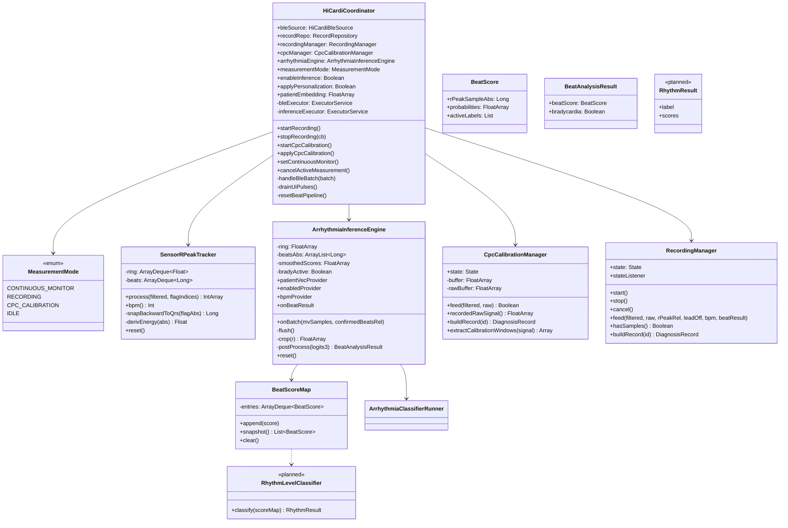

> `RhythmLevelClassifier`와 `RhythmResult`는 Stage B 구현을 위한 설계 요소이며, 현재 존재하는 런타임 클래스라는 의미가 아니다. 실제 코드와 동기화할 때는 구현 완료 전까지 `planned` 상태를 유지한다.

스레드 공유 필드의 가시성은 `@Volatile` 또는 명시적인 동기화로 보장한다. 대상 필드에는 `measurementMode`, `enableInference`, `applyPersonalization`, `patientEmbedding`, `lastBpm`, `lastPred` 및 각 매니저의 `state`가 포함된다. `extractCalibrationWindows`는 static 함수로 취급한다. `CpcCalibrationManager`의 filtered/raw 버퍼는 각각 15,000 샘플(60초)을 저장한다.

### 3.2 BLE 소스 및 신호

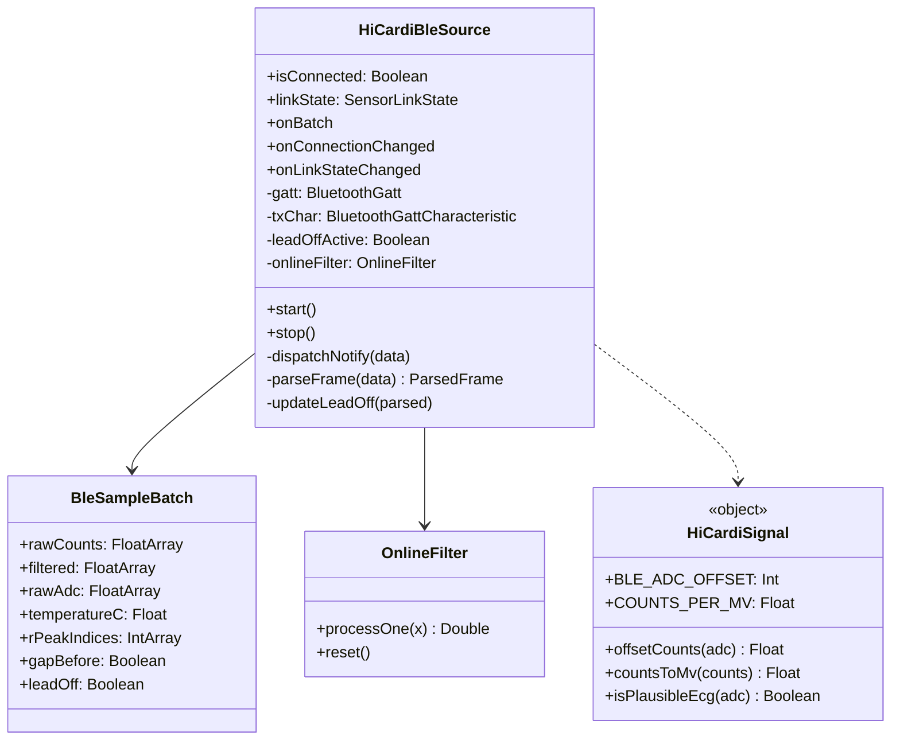

- `BleSampleBatch.rawCounts`: `adc - 16384`로 오프셋을 보정한 counts
- `BleSampleBatch.filtered`: `OnlineFilter` 처리 및 mV 변환 후 신호
- `BleSampleBatch.rawAdc`: 원 ADC 값
- `BleSampleBatch.rPeakIndices`: `0xFF` tag 위치
- `HiCardiSignal`: `BLE_ADC_OFFSET=0x4000`, `COUNTS_PER_MV=1000`
- `@Volatile` 대상: `isConnected`, `linkState`, `gatt`, `txChar`, `leadOffActive`

### 3.3 추론 모델 계층

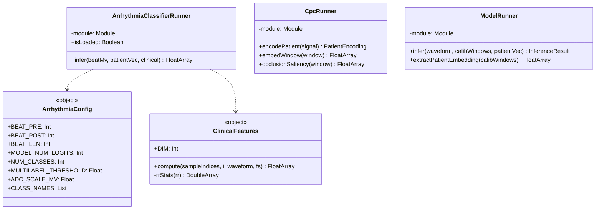

Stage A 계약상 `ArrhythmiaClassifierRunner.infer(beatMv, patientVec, clinical)`의 입력은 `beatMv[501]`, `patientVec[256]`, `clinical[32]`이며, 반환값은 클래스 순서 `[Normal, APC, VPC]`에 대응하는 logit 3개다. sigmoid와 임계값 처리는 `ArrhythmiaInferenceEngine`에서 담당한다. 실제 ExecuTorch 바인딩이 배치 차원을 포함하는 경우 입력 텐서 shape는 `[1,1,501]`, `[1,256]`, `[1,32]`다.

`ModelRunner`는 기존 27-class `model.pte` 레거시 경로다. 이 러너의 입출력 계약을 Stage A `classifier.pte` 계약과 혼용하지 않는다.

### 3.4 데이터 모델 및 저장

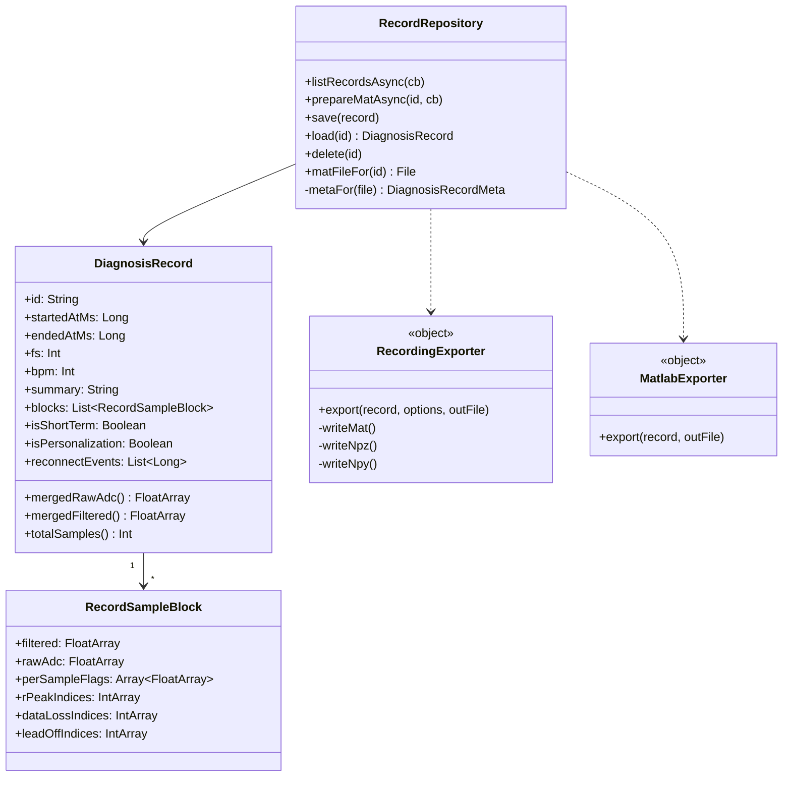

- `RecordRepository.listRecordsAsync` 및 `prepareMatAsync`는 IO 스레드에서 작업하고 메인 스레드로 콜백한다.
- `metaFor`는 `{id}.meta.json` 사이드카를 읽어 목록 표시 시 본문 전체 파싱을 피한다.
- `RecordingExporter.Options`: `includeAdc`, `includeMv`, `format ∈ {MAT, NPZ}`
- `MatlabExporter`: MATLAB v5 포맷의 7개 변수 출력
- beat score map은 실시간 추론용 점수 기록 구조다. 현재 레코드 JSON 및 MAT/NPZ 스키마에 클래스별 score map 시계열이 자동으로 포함된다고 가정하지 않는다. score map을 녹화 파일에도 보존하려면 별도의 스키마 확장이 필요하다.

---

## 4. 시퀀스 다이어그램

### 4.1 실시간 모니터 — 배치 처리 및 Stage A 추론

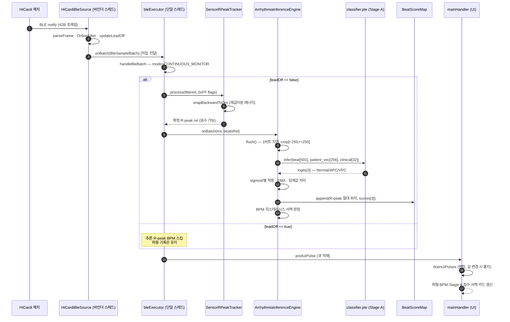

Stage B가 구현되기 전에는 위 시퀀스에서 리듬 분류를 호출하지 않는다. `AF_AFL` 또는 `Sinus_Tachy`를 Stage A의 출력으로 표시하지 않는다.

### 4.2 레코딩 — 시작, 중지, 저장/내보내기

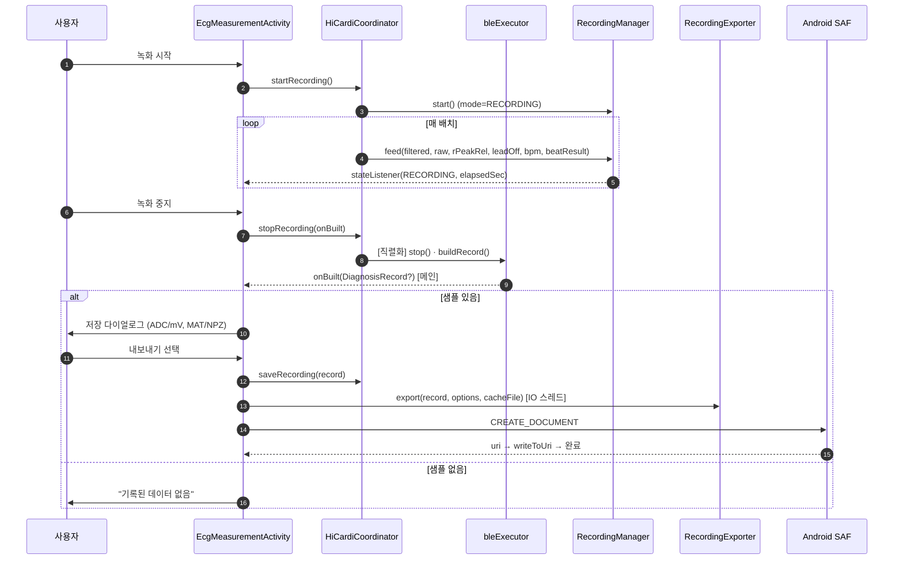

### 4.3 CPC 개인화 캘리브레이션 (60초)


---

## 5. 상태 기계 (State Machines)

### 5.1 측정 모드 (`MeasurementMode`)

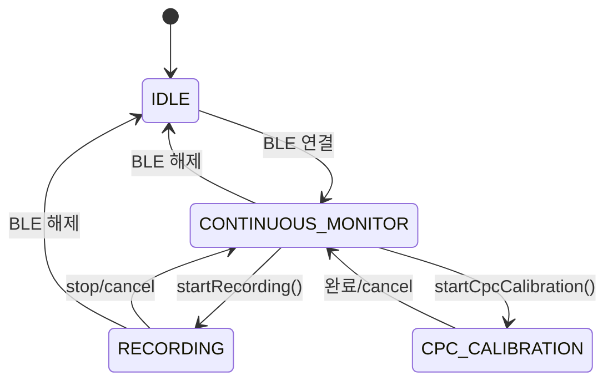

### 5.2 서맥 규칙 (BPM 히스테리시스)

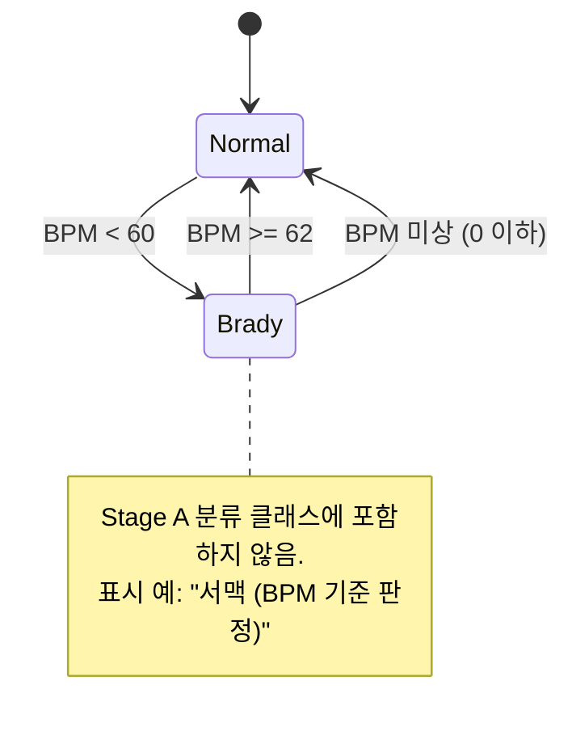

### 5.3 Lead-off 휴리스틱 (프레임 폐기 비율)

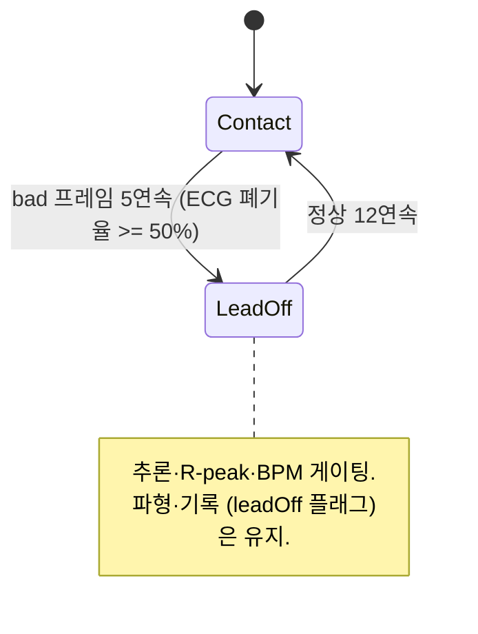

---

## 6. 스레딩 모델

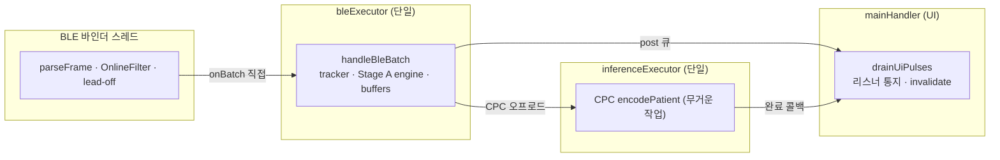

### 가시성 및 동시성 규칙

- 스레드 간 공유 필드는 `@Volatile` 또는 적절한 동기화로 보호한다. 대상에는 `measurementMode`, `enableInference`, `applyPersonalization`, `patientEmbedding`, `lastBpm`, `lastPred`, BLE의 `gatt`, `txChar`, `isConnected`, `linkState`, `leadOffActive`, 각 매니저의 `state`가 포함된다.
- 리스너 목록은 `CopyOnWriteArrayList`를 사용해 콜백 중 자기 제거로 인한 `ConcurrentModificationException`을 방지한다.
- `stopRecording` 및 `resetBeatPipeline`은 `bleExecutor`에 직렬화해 배치 처리와의 경합을 막는다.
- tracker와 inference engine의 내부 가변 상태는 `bleExecutor`에서만 접근한다.
- CPC 인코딩 완료 콜백은 공유 임베딩을 갱신할 때 메모리 가시성과 현재 측정 상태를 확인한다.
- Stage B 구현 시에도 score map의 소유 스레드와 읽기 스냅샷 경계를 명시한다. Stage B가 별도 스레드에서 score map을 읽도록 구현한다면 불변 snapshot 또는 동기화된 큐를 사용한다.

---

## 7. 알고리즘

### 7.1 R-peak backward 재스냅

**문제:** 센서 온칩 `0xFF` 플래그는 박동의 개수와 간격(RR)은 비교적 정확하게 전달하지만, 실제 QRS 위치보다 늦게 보고되는 위치 오차가 관찰됐다. `rec.npz` 측정에서는 플래그가 QRS 기준으로 `-360 ms` 또는 `+324 ms` 부근에 위치하는 경우가 있었고, RR은 약 `684 ms`였다. 기존의 `±60 ms` 전방 스냅은 적중률이 0%였으며, 이에 따라 crop `[r-250, r+250]`이 QRS가 아닌 기저선 중심으로 잡힐 수 있었다.

**해법:** `0xFF`는 박동 트리거 및 refractory 제어에 사용하고, 위치는 플래그 이전 구간에서 제곱미분 에너지를 최대화한 뒤 원신호 극점으로 재스냅한다. backward 탐색이므로 탐색에 미래 샘플을 요구하지 않는다.

```text
snapBackwardToQrs(flagAbs):
  loC = flagAbs - 0.50 * fs       # 500 ms 전
  hiC = flagAbs - 0.20 * fs       # 200 ms 전
  if 히스토리 부족:
      return flagAbs

  mean = ring[loC..hiC] 평균       # baseline 근사
  bestC = argmax_c derivEnergy(c), c in [loC, hiC]
  # derivEnergy(i) = mean_{k=-3..3} ((ring[i+k+1]-ring[i+k-1])/2)^2
  bestR = argmax_r |ring[r] - mean|, r in [bestC ± 0.02 * fs]
  return bestR
```

**대안 비교 기록 (`rec.npz` 검증):**

| 방법 | 탐지 개수 | 위치 정확도 | 비고 |
|---|---:|---|---|
| 원본 `0xFF` | 64 | 60 ms 허용 기준 0%; 중앙 오프셋 약 +294 ms | 위치를 그대로 사용하기 어려움 |
| 독립 Pan-Tompkins 스트리밍 | 30 | 탐지된 피크 정밀도 100%, recall 47% | 임계값 튜닝이 어렵고 박동 수 손실 |
| 대칭 `±360 ms` 스냅 | — | RR 붕괴 | 앞뒤 QRS를 함께 포함할 수 있음 |
| **Backward 방향성 스냅** | **64** | **60 ms 기준 100%, 중앙 오프셋 +2 ms, 충돌 0** | 박동 수 보존과 위치 정확도 목표 |

**단위 테스트:** `SensorRPeakTrackerTest`의 실 녹화 CSV fixture 스트리밍에서 `n=64`, `60 ms` 기준 98%, 중앙값 0 ms로 기록되어 있다. 위 대안 비교와 테스트 표본/집계 기준이 서로 다르므로, 보고서에는 각 평가 설정과 허용 오차를 함께 제시한다.

**하류 처리:** 재스냅된 상대 인덱스는 과거 위치를 가리켜 음수일 수 있다. 기록 및 모델 crop은 절대 샘플 인덱스 기준으로 교정된 위치를 사용한다. `EcgPlotView`는 음수 상대 인덱스를 과거 버퍼의 위치로 매핑해 마커를 그린다.

### 7.2 Pan-Tompkins 스트리밍 지연 측정

설계 검증용 causal Pan-Tompkins(2차 Butterworth 5–15 Hz 필터 → causal 5-tap 미분 → 제곱 → 120 ms trailing 적분 → 적응 임계값 SPKI/NPKI)에서 MWI peak가 QRS보다 약 96 ms 늦게 나타났으며, 기록된 p10–p90 범위는 64–102 ms다. 이 결과는 backward 탐색 창을 QRS 후보 이전 200 ms 이상부터 시작하는 설계의 보조 근거다. 독립 Pan-Tompkins는 recall이 충분하지 않아 실제 센서 tag를 대체하는 트리거로 사용하지 않는다.

### 7.3 임상 32-D 특징 (`ClinicalFeatures`)

`ClinicalFeatures.compute`는 `PECG-HiCardi/src/data/clinical_features.py`와의 수치 일치를 목표로 한다. 기록된 Python parity 기준은 `max|Δ| < 1e-5`다.

```text
rr_all[i] = (sampleIndex[i+1] - sampleIndex[i]) / fs
pre_rr  = rr_all[i-1] (i > 0 else 0)
post_rr = rr_all[i]   (i < n-1 else 0)  # 다음 R-peak를 이용하므로 한 비트 지연

local  = rr_all[i-10:i]
global = rr_all[i-20:i]  # 모두 현재 비트 이전의 RR 구간

rr_stats(rr) = mean, std(ddof=0) + 1e-8, skew, excess_kurtosis

feat[0..9]  = pre_rr, post_rr,
              pre_rr/(local_mean+ε), post_rr/(local_mean+ε),
              local_mean, local_std, local_skew, local_kurtosis,
              global_mean, global_std
feat[10]    = max(seg) - min(seg)              # P-P
feat[11]    = sqrt(mean(seg^2))                # RMS
feat[12]    = mean(seg[0.4L:0.6L]^2)            # 중앙 20% 에너지
feat[13:32] = seg[linspace(0, L-1, 19) -> int] # 정수 인덱스로 샘플링
```

비트 crop `seg`는 모델 입력과 동일한 mV 스케일인 `(adc - 16384) / 1000`으로 계산한다. 특징 계산에서 사용하는 R-peak 순서와 RR 구간 인덱싱은 학습 측 구현과 일치해야 한다. 특히 `post_rr`는 다음 R-peak가 관측된 후에야 확정되므로 완전한 무지연 실시간 특징으로 해석하지 않는다.

### 7.4 CPC 개인화 임베딩

```text
총 신호 길이 = 15000 samples (60 s)
window length = 500 samples (2 s)
hop = 250 samples (1 s)

num_windows = floor((15000 - 500) / 250) + 1 = 59

각 윈도우 w:
  z-score 정규화
  cpc_model.pte -> embedding[256]
  L2 정규화

pooled = mean_w(embedding_w)
patient_vec[256] = L2_normalize(pooled)
```

주 경로 `CpcRunner.encodePatient`는 신호 전체를 hop 250으로 타일링해 59개 윈도우를 생성한다. 이 경로는 `NUM_CALIB` 상수에 의존하지 않는다. `NUM_CALIB=59`는 레거시 `model.pte`의 `[1,59,1,500]` 입력 계약에 사용되며, shape가 맞지 않을 때 무조건부 forward로 폴백하는 기존 동작은 Stage A와 혼동하지 않도록 유지한다.

### 7.5 서맥 판정 (모델 미사용)

```text
postProcess(logits3, bpm):
  probs3 = sigmoid(logits3)                 # [Normal, APC, VPC]
  smoothed3 = EMA(probs3, α=0.3)            # 구현에서 smoothing을 유지하는 경우
  activeLabels = {k | smoothed3[k] >= 0.5}

  bradyActive =
      false, if bpm <= 0
      true,  if bpm < 60
      false, if bpm >= 62
      previous state, otherwise

  return BeatAnalysisResult(
      beatScore = {probabilities: smoothed3, activeLabels: activeLabels},
      bradycardia = bradyActive
  )
```

서맥 상태는 BPM 히스테리시스로 결정하고 Stage A logit에서 추출하지 않는다. 기존 `BRADY_LOGIT_INDEX=4`를 제거하는 것이 새로운 Stage A 계약의 핵심이다. EMA가 실제 Android 구현에서 활성화되어 있는지와 EMA 초기화/리셋 규칙은 코드와 대조해야 한다.

### 7.6 Lead-off 휴리스틱

```text
프레임마다:
  ecgTags = 유효 태그 + 폐기 태그(isPlausibleEcg 실패)
  bad = (폐기 ECG 태그 수 >= 유효 ECG 태그 수)

  bad 5회 연속   -> LeadOff 진입
  정상 12회 연속 -> LeadOff 해제

LeadOff 동안:
  추론, R-peak, BPM 갱신은 게이팅
  파형 및 기록은 유지하고 leadOff 플래그를 남김
```

전용 lead-off 센서 플래그가 없으므로 ECG 샘플의 특성으로 전극 이탈을 추정한다. 깨끗한 평탄선 형태의 탈착은 검출하지 못할 수 있다. 진폭/분산 기반 보강은 backlog에 포함한다.

### 7.7 임상 캘리브레이션 렌더링

```text
캘리브레이션 모드: 20 mm/mV, 25 mm/s
pxPerMm = dpi / 25.4
가시 yRange = plotH_px / (mmPerMv * pxPerMmY), 0 mV 중앙
가시 xWindowSec = plotW_px / (mmPerSec * pxPerMmX)  # onSizeChanged 기준
그리드: 1 mm 얇은 선 / 5 mm 굵은 선
1 mV 마커 높이 = mmPerMv * pxPerMmY
표시 신호 = (adc - 16384) / 1000 mV
```

### 7.8 UI 펄스 병합

BLE 배치(약 22회/s)마다 메인 스레드 작업을 무조건 post하지 않고 큐에 적재한다. 메인 루퍼의 `drainUiPulses`가 작업을 묶어 처리한다. 파형은 모든 배치를 반영해 연속성을 유지하고, BPM·진단 점수·체온은 값이 바뀔 때만 리스너를 통지해 불필요한 UI 갱신을 줄인다.

---

## 8. 온디바이스 모델 명세 (SSOT 계약)

기존 배포 명세 출처: `G:\...\classifier\DEPLOYMENT_ONDEVICE_SPEC.md`. 아래 Stage A 항목은 새 3-class 모델을 export하고 Android와 shape parity를 확인해야 하는 목표 계약이다.

### 8.1 공통 상수

```text
FS_HZ = 250
ADC_SCALE = 1000

BEAT_PRE = 250
BEAT_POST = 250
BEAT_LEN = 501

CLINICAL_DIM = 32
PATIENT_DIM = 256

CALIB_SECONDS = 60
CALIB_WINDOW_SEC = 2.0
CALIB_OVERLAP = 0.5
CALIB_NUM_WINDOWS = 59

NUM_CLASSES = 3
MULTILABEL_THRESHOLD = 0.5
CLASS_NAMES = [Normal, APC, VPC]
```

ADC 변환은 소스에 따라 구분한다.

- Holter: `(adc - 8192) / 1000`
- HiCardi 모니터: `(adc - 16384) / 1000`

### 8.2 모델 입출력 계약

| 모델 | 입력 | 출력 | 상태 |
|---|---|---|---|
| `classifier.pte` | `x[1,1,501]` mV, `patient_vec[1,256]`, `clinical[1,32]` | `logits[1,3]` → 클래스별 sigmoid | Stage A의 목표 계약. 실제 export 후 검증 필요 |
| `cpc_model.pte` | `window[1,1,500]` z-score | `embedding[1,256]` | CPC 개인화 인코더 |
| `model.pte` (레거시) | `beat[1,1,501]` + `calib[1,59,1,500]` | 기존 27-class logits | Stage A와 분리해 유지 |

### 8.3 Stage A 출력 의미

클래스 순서는 반드시 다음과 같다.

```text
logits[0] -> Normal
logits[1] -> APC
logits[2] -> VPC
```

각 logit에 sigmoid를 독립 적용한다. 점수 합은 1이 아니며, softmax 적용 또는 합이 1이 되도록 하는 재정규화를 금지한다. `MULTILABEL_THRESHOLD=0.5`로 클래스별 활성 여부를 산출하되 하나의 `topIndex`로 결과를 강제 축약하지 않는다.

### 8.4 이전 6-logit 계약과의 차이

기존 계약은 다음 6개 logit을 사용했다.

```text
[Normal, Sinus_Tachy, APC, AF_AFL, Bradycardia, VPC]
```

이전 Android 후처리는 `BRADY_LOGIT_INDEX=4`를 버리고 나머지 5개 클래스를 표시했다. **이 계약은 새 Stage A에서는 더 이상 유효하지 않다.**

새 Stage A에서는 다음 변경이 필요하다.

- `MODEL_NUM_LOGITS=3`
- `NUM_CLASSES=3`
- `BRADY_LOGIT_INDEX` 제거
- `CLASS_NAMES=[Normal, APC, VPC]`
- 서맥은 BPM rule로 판정
- `Sinus_Tachy` 및 `AF_AFL`은 Stage A 출력에서 제거하고 향후 Stage B 계약으로 분리
- 기존 `classifier.pte` export 파일, Android runner의 출력 shape 검사, 후처리, UI 표시를 함께 갱신

`model.pte`의 레거시 27-class 모델은 위 변경의 대상이 아니다.

---

## 9. 데이터 명세

### 9.1 BLE 42-byte 프레임

```text
byte 0      : 0x80 sync
byte 1      : 프레임 시퀀스 카운터
byte 2-4    : 63 01 00 상수
byte 5-7    : tag 0xF1 별도 채널 (메인 ECG 아님)
byte 8-37   : ECG 10샘플 [tag, hi, lo]
               value = (hi << 8 | lo) - 0x4000, 250 Hz
               tag 0xF0 = 정상, 0xFF = R-peak 표시 샘플
byte 38-40  : 텔레메트리 멀티플렉스 (회전 필드 ID, 온도 포함)
byte 41     : 0x8F 프레임 끝
```

### 9.2 레코드 JSON 스키마 (`{id}.json`)

```json
{
  "id": "...",
  "startedAtMs": 0,
  "endedAtMs": 0,
  "fs": 250,
  "bpm": 0,
  "summary": "...",
  "isShortTerm": false,
  "isPersonalization": false,
  "reconnectEvents": [],
  "blocks": [
    {
      "filtered": [],
      "rawAdc": [],
      "perSampleFlags": [],
      "rPeakIndices": [],
      "dataLossIndices": [],
      "leadOffIndices": []
    }
  ]
}
```

목록 성능을 위한 사이드카 `{id}.meta.json`에는 `{id, startedAtMs, bpm, summary, isShortTerm, isPersonalization}`를 저장해 본문 전체 파싱을 피한다.

Stage A score map은 실시간 분류 파이프라인의 별도 데이터다. 현재 JSON 스키마에는 클래스별 sigmoid 점수 시계열이 포함되어 있지 않다. 기록 재생 또는 사후 리듬 분석에 점수까지 필요하다면 `beatScores[]` 등 명시적인 스키마와 버전 관리가 필요하다.

### 9.3 레코딩 내보내기 (`RecordingExporter`, `.mat` v5 / `.npz`)

샘플 정렬 배열은 float64 컬럼으로 내보내며 스칼라 메타데이터를 함께 기록한다.

| 컬럼 | 의미 |
|---|---|
| `ecg_adc[n]` | 원 16-bit ADC 값 |
| `ecg_mv[n]` | `(adc - 16384) / 1000`, HiCardi 기준 mV |
| `rpeak[n]` | 재스냅된 R-peak 위치의 0/1 표시 |
| `data_lost[n]` / `lead_off[n]` | 데이터 손실 및 lead-off 표시(0/1) |
| `t_sec[n]` | 시작 기준 경과 초, `i/fs` |
| `ts_ms[n]` | epoch ms, `start_ms + i·1000/fs` |
| `fs[1]`, `start_ms[1]` | 샘플링레이트 및 시작 시각 스칼라 |

장시간 녹화에서 전체 데이터를 힙에 한꺼번에 올리지 않도록 값 단위 스트리밍 작성 방식을 사용한다. 기록상 `scipy.loadmat` 및 `numpy.load`로 읽기 검증을 완료했다.

### 9.4 레거시 `.mat` (`MatlabExporter`, v5, 7개 변수)

기존 변수명은 다음과 같다.

`dECG`, `final_flag`, `Rpk_flag`, `fs`, `Rthm_label`, `data_lost`, `LeadOff`

Scipy 호환을 유지한다. 레거시 파일 포맷에 Stage A의 beat score map이 자동 추가되는 것으로 간주하지 않는다.

---

## 10. 파일 및 모듈 맵

| 영역 | 경로 | 역할/상태 |
|---|---|---|
| 오케스트레이션 | `HiCardiCoordinator.kt`, `MeasurementMode.kt` | 앱 상태와 데이터 흐름 조정 |
| BLE·신호 | `HiCardiBleSource.kt`, `BleSampleBatch.kt`, `HiCardiSignal.kt`, `OnlineFilter.kt`, `SensorRPeakTracker.kt` | BLE 파싱, 필터링, R-peak 처리 |
| 세션 | `session/ArrhythmiaInferenceEngine.kt`, `CpcCalibrationManager.kt`, `RecordingManager.kt`, `CpcRunner.kt`, `PersonalizationQuality.kt` | Stage A 추론, CPC, 기록 세션 |
| Stage A 모델 | `ArrhythmiaClassifierRunner.kt`, `ArrhythmiaConfig.kt`, `ClinicalFeatures.kt` | 3-logit Normal/APC/VPC 모델 계약으로 갱신 필요 |
| Stage A score map | `BeatScoreMap.kt` 또는 동등한 구현 | 비트별 점수의 시간순 저장. 실제 파일명은 구현과 동기화 |
| Stage B | `docs/beat_score_map/beat_score_classifier.py` | **미구현/준비 필요**. 리듬 분류기 학습 및 계약 정의 |
| 레거시 모델 | `ModelRunner.kt`, `ModelConfig.kt` | 기존 27-class `model.pte` 경로 |
| 데이터 | `data/DiagnosisRecord.kt`, `RecordRepository.kt`, `RecordingExporter.kt`, `MatlabExporter.kt`, `RecordMatActions.kt` | 기록 및 파일 내보내기 |
| 표시 | `EcgPlotView.kt`, `GraphSettings.kt`, `StripRecordView.kt`, `StripRecordBuffer.kt` | ECG 표시 |
| UI | `ui/home/*Fragment.kt`, `ui/measurement/EcgMeasurementActivity.kt`, `ui/record/RecordDetailActivity.kt`, `ui/widget/*` | 앱 UI |
| 테스트 | `test/.../SensorRPeakTrackerTest.kt`, `RecordingExporterTest.kt`, `test/resources/rec_*.csv` | R-peak 및 내보내기 테스트 |

---


**빌드:** Android Studio JBR 환경에서 `gradlew :app:assembleDebug`를 사용한다. 기존 기록에서는 일반 `java`가 PATH에 등록되지 않은 환경이었다.


---
